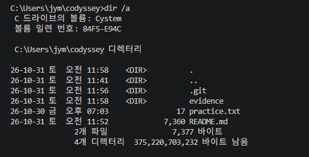
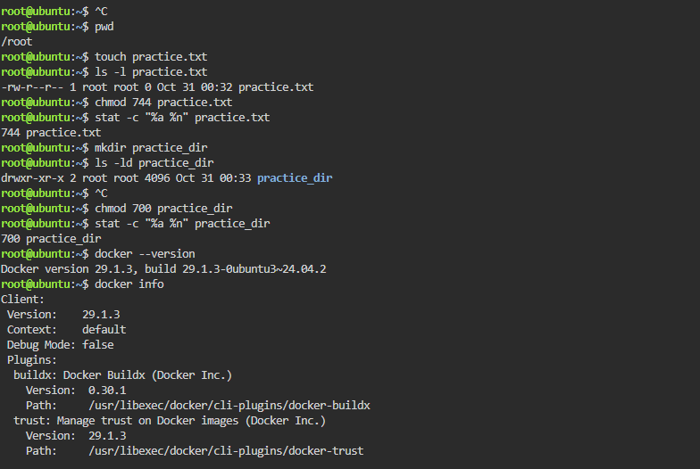
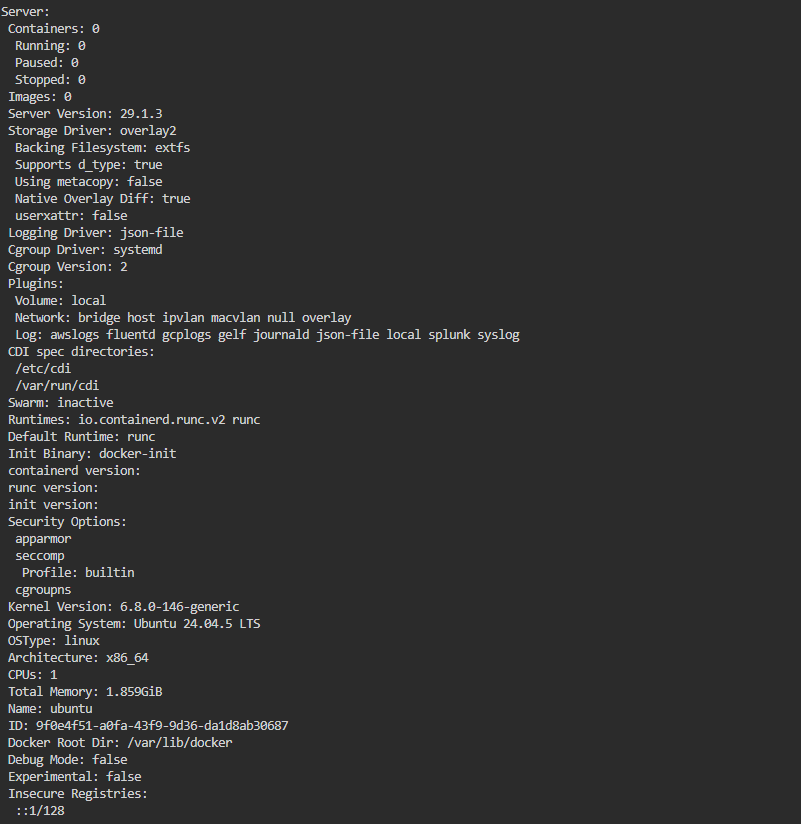
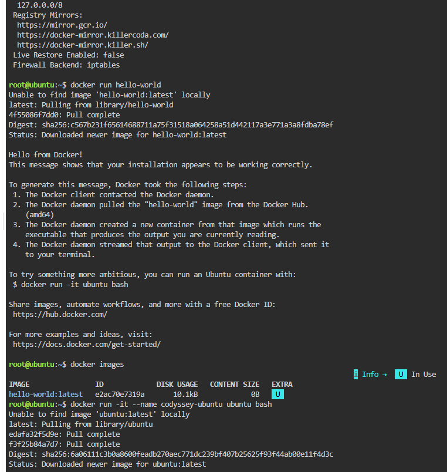
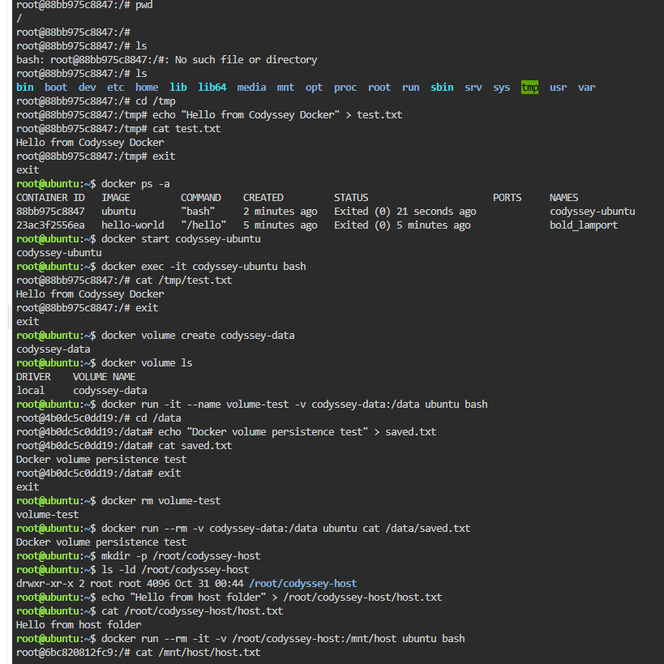
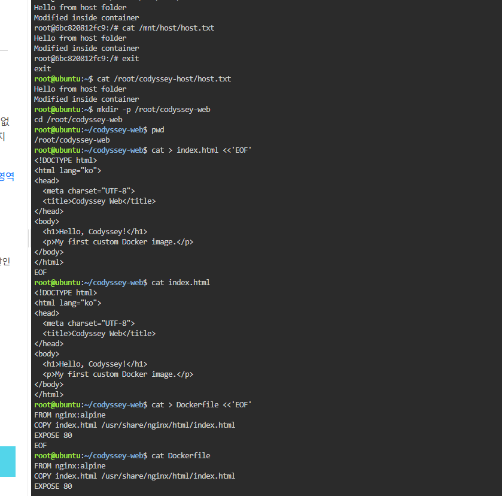
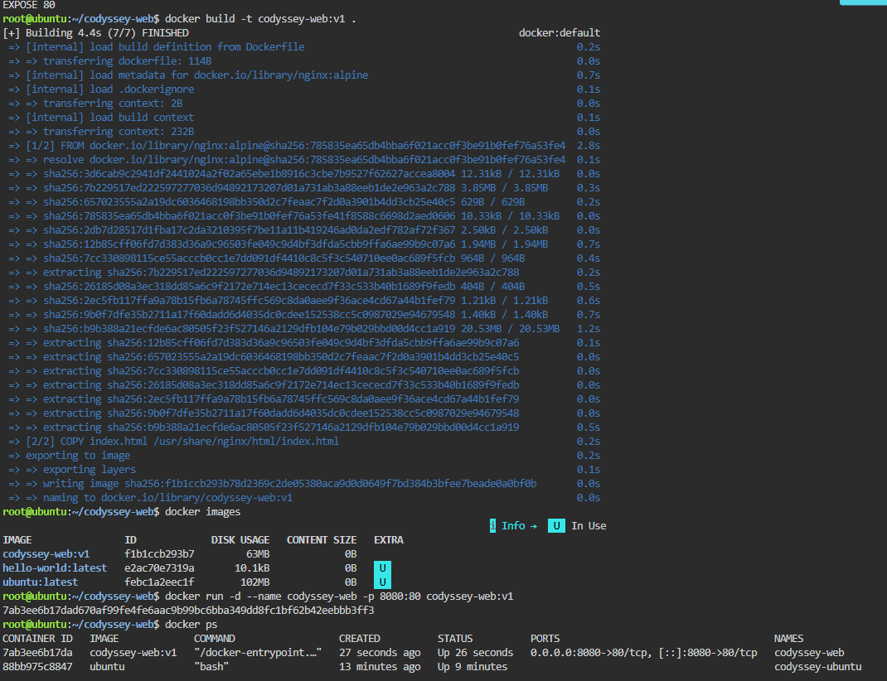
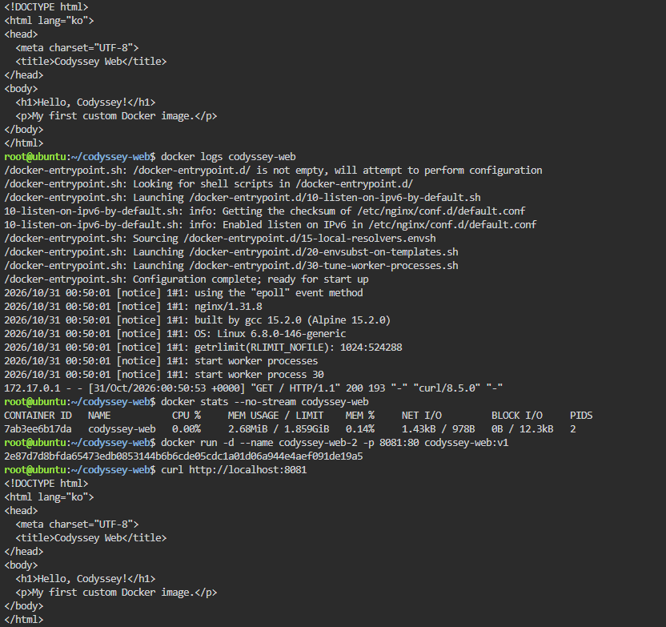
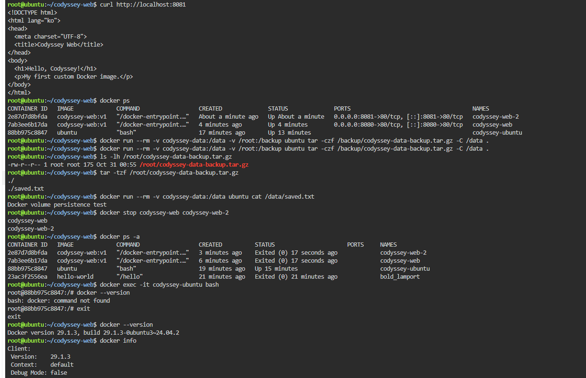
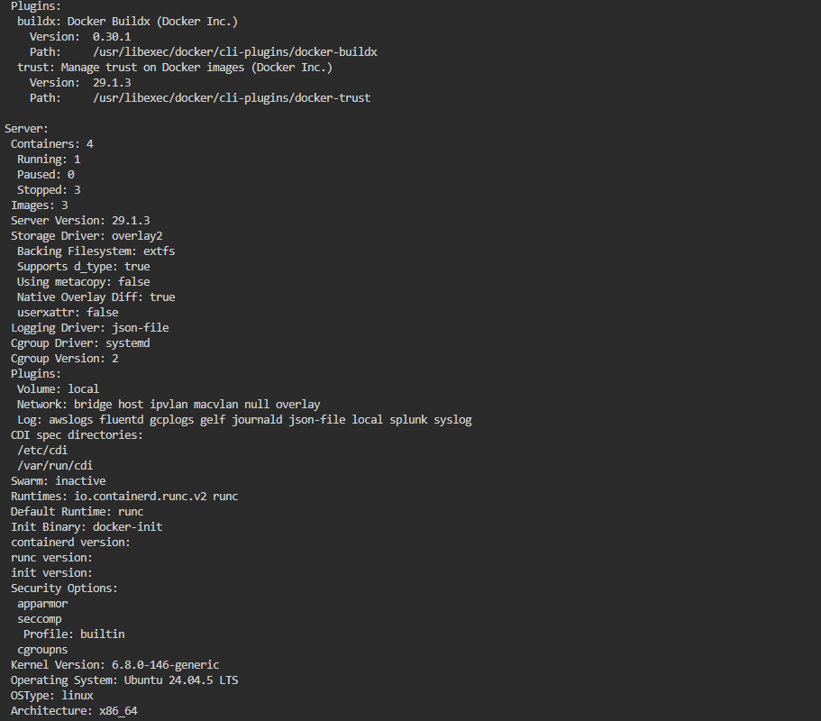

# Codyssey AI All-in-One Mission
## 내 컴퓨터에 개발자용 작업실 꾸미기

### 1. 프로젝트 소개
개발 환경을 구성하고 Windows 터미널, Linux, Git, GitHub, Docker의 기본 기능을 실습한 프로젝트입니다.

### 2. 실습 환경

| 항목 | 환경 |
|---|---|
| 개인 PC OS | Windows |
| 터미널 | CMD, Git Bash |
| 코드 편집기 | Visual Studio Code 1.144.0 |
| Git | 2.56.0.windows.4 |
| Linux 실습 환경 | Killercoda Ubuntu 24.04 |
| Docker | 29.1.3 |

※ Docker와 Linux 실습은 Windows PC가 아닌 Killercoda의 임시 Ubuntu 환경에서 진행했습니다.

### 3. 실습 체크리스트

- [x] 터미널 기본 명령어 실습
- [x] 파일 및 디렉터리 생성·복사·이동·삭제
- [x] Linux 파일 및 디렉터리 권한 변경
- [x] Docker 버전 및 엔진 정보 확인
- [x] Docker 이미지 다운로드 및 목록 확인
- [x] 컨테이너 실행·중지·목록 확인
- [x] Dockerfile 작성 및 사용자 정의 이미지 빌드
- [x] 포트 매핑 및 웹 서버 접속 확인
- [x] Docker Volume 데이터 유지 확인
- [x] Bind Mount 파일 공유 확인
- [x] Volume 백업 파일 생성 및 내부 목록 확인
- [x] Git 설정 및 GitHub 저장소 연결

### 4. 터미널 기본 명령어

Windows CMD에서 다음 작업을 실습했습니다.

| 작업 | 명령어 |
|---|---|
| 현재 위치 확인 | `cd` |
| 파일 목록 확인 | `dir` |
| 숨김 파일 포함 확인 | `dir /a` |
| 폴더 이동 | `cd 폴더명` |
| 폴더 생성 | `mkdir 폴더명` |
| 빈 파일 생성 | `type nul > 파일명` |
| 파일 내용 작성 | `echo 내용 > 파일명` |
| 파일 내용 확인 | `type 파일명` |
| 파일 복사 | `copy 원본 복사본` |
| 파일 이름 변경 | `ren 기존이름 새이름` |
| 파일 이동 | `move 파일명 폴더명` |
| 파일 삭제 | `del 파일명` |
| 빈 폴더 삭제 | `rmdir 폴더명` |

### 5. Linux 권한 실습

Killercoda Ubuntu에서 파일과 디렉터리의 권한을 확인하고 변경했습니다.

파일 권한:
```bash
touch practice.txt
stat -c "%a %n" practice.txt
chmod 744 practice.txt
stat -c "%a %n" practice.txt
```

디렉터리 권한:
```bash
mkdir practice_dir
ls -ld practice_dir
chmod 700 practice_dir
stat -c "%a %n" practice_dir
```

실습 결과:
- 파일 권한: 644 → 744
- 디렉터리 권한: 755 → 700

권한의 의미:
- r: 읽기
- w: 쓰기
- x: 실행 또는 디렉터리 접근

### 6. Docker 기본 실습

Docker 버전 및 엔진 정보:
```bash
docker --version
docker info
```

기본 이미지 실행:
```bash
docker run hello-world
docker images
```

Ubuntu 컨테이너 실행:
```bash
docker run -it --name codyssey-ubuntu ubuntu bash
```

컨테이너 내부에서 `pwd`, `ls`, `cd`, `echo`, `cat` 명령어를 실습했습니다.

컨테이너 확인:
```bash
docker ps
docker ps -a
docker start codyssey-ubuntu
docker exec -it codyssey-ubuntu bash
docker logs codyssey-web
docker stats --no-stream codyssey-web
```

### 7. 사용자 정의 Docker 이미지 제작

Nginx 기반 Dockerfile을 작성했습니다.

Dockerfile:
```dockerfile
FROM nginx:alpine
COPY index.html /usr/share/nginx/html/index.html
EXPOSE 80
```

이미지 빌드:
```bash
docker build -t codyssey-web:v1 .
docker images
```

컨테이너 실행:
```bash
docker run -d --name codyssey-web -p 8080:80 codyssey-web:v1
```

웹 서버 접속 확인:
```bash
curl http://localhost:8080
```

두 번째 포트도 확인했습니다.
```bash
docker run -d --name codyssey-web-2 -p 8081:80 codyssey-web:v1
curl http://localhost:8081
```

두 포트 모두 `Hello, Codyssey!`가 포함된 HTML을 정상 출력했습니다.

### 8. Docker Volume 실습

볼륨 생성:
```bash
docker volume create codyssey-data
docker volume ls
```

볼륨에 데이터 저장:
```bash
docker run -it --name volume-test -v codyssey-data:/data ubuntu bash
```

컨테이너 내부에서:
```bash
echo "Docker volume persistence test" > /data/saved.txt
cat /data/saved.txt
```

테스트 컨테이너 삭제:
```bash
docker rm volume-test
```

새 컨테이너에서 데이터 확인:
```bash
docker run --rm -v codyssey-data:/data ubuntu cat /data/saved.txt
```

출력 결과:
```text
Docker volume persistence test
```

컨테이너를 삭제한 후에도 볼륨의 데이터가 유지되는 것을 확인했습니다.

### 9. Bind Mount 실습

호스트 디렉터리 생성 및 파일 작성:
```bash
mkdir -p /root/codyssey-host
echo "Hello from host folder" > /root/codyssey-host/host.txt
```

컨테이너에 연결:
```bash
docker run --rm -it -v /root/codyssey-host:/mnt/host ubuntu bash
```

컨테이너 내부에서 확인 및 수정:
```bash
cat /mnt/host/host.txt
echo "Modified inside container" >> /mnt/host/host.txt
```

호스트에서도 변경된 내용을 확인했습니다.

### 10. Volume 백업

볼륨 데이터를 압축 파일로 백업했습니다.

```bash
docker run --rm -v codyssey-data:/data -v /root:/backup ubuntu tar -czf /backup/codyssey-data-backup.tar.gz -C /data .
```

백업 파일 확인:
```bash
ls -lh /root/codyssey-data-backup.tar.gz
tar -tzf /root/codyssey-data-backup.tar.gz
```

압축 파일 내부에서 `saved.txt`를 확인했습니다.

※ 백업 파일 생성과 내부 목록 확인까지 진행했으며, 복원 실습은 진행하지 않았습니다.

### 11. Git 및 GitHub

Git 사용자 설정:
```bash
git config --global user.name "Jiyoung"
git config --global user.email "내 GitHub 이메일"
git config --global init.defaultBranch main
git config --global --list
```

저장소 초기화 및 커밋:
```bash
git init
git add practice.txt
git commit -m "Add practice file"
git status
```

GitHub 원격 저장소 연결:
```bash
git remote add origin https://github.com/jangbang37/codyssey-ai-workspace.git
git push -u origin main
```

GitHub 저장소:
https://github.com/jangbang37/codyssey-ai-workspace

### 12. 문제 해결 기록

**문제 1. Git 명령어를 인식하지 못함**

- 원인: Git 실행 파일 경로가 Windows PATH에 등록되지 않음
- 해결: `C:\Program Files\Git\cmd`를 사용자 PATH에 추가
- 확인: `git --version` 정상 출력

**문제 2. Git 설정 파일을 찾을 수 없음**

- 원인: 최초 Git 사용자 설정이 되어 있지 않았음
- 해결: `git config --global`로 사용자 이름, 이메일, 기본 브랜치 설정

**문제 3. Git Bash에서 chmod 변경이 반영되지 않음**

- 원인: Windows NTFS 환경의 Git Bash에서는 Linux와 같은 권한 변경이 그대로 반영되지 않을 수 있음
- 해결: Killercoda Ubuntu에서 권한 변경을 다시 실습하고 결과 확인

**문제 4. Docker 명령어를 찾을 수 없음**

- 원인: Ubuntu 컨테이너 내부에서 Docker 명령어를 실행함
- 해결: `exit`로 호스트 터미널로 돌아와 Docker 명령어 실행

### 13. 마무리

이번 실습을 통해 터미널 사용법, Linux 권한 관리, Git 및 GitHub 버전 관리, Docker 이미지와 컨테이너, 포트 매핑, Volume 및 Bind Mount의 기본 개념을 익혔습니다.
---

## 14. 실습 증거 스크린샷

실습 과정과 실행 결과를 확인할 수 있도록 증거 화면을 첨부했습니다.

### 1) Windows 터미널 환경


### 2) Linux 권한 및 Docker 확인


### 3) Docker Volume 데이터 유지


### 4) Docker Hello World 실행


### 5) Docker 컨테이너 실행 및 목록


### 6) 사용자 정의 이미지 제작


### 7) Docker 이미지 및 포트 매핑


### 8) Docker 로그 및 리소스 확인


### 9) Docker Volume 백업


### 10) Linux 실행 환경

## 15. 핵심 개념 정리

### 15-1. 절대 경로와 상대 경로

- 절대 경로: 현재 위치와 관계없이 루트부터 파일까지의 전체 경로이다.
- 상대 경로: 현재 작업 위치를 기준으로 파일이나 폴더를 나타내는 경로이다.

예시:
- 절대 경로: `/root/codyssey-web/index.html`
- 상대 경로: `index.html` 또는 `./index.html`
- `..`은 현재 폴더의 상위 폴더를 의미한다.

### 15-2. Docker 이미지와 컨테이너

- 이미지(Image): 컨테이너를 만들 때 사용하는 실행 환경과 파일의 묶음이다.
- 컨테이너(Container): 이미지를 바탕으로 실제 실행한 독립적인 환경이다.
- 하나의 이미지로 여러 컨테이너를 만들 수 있다.

이번 실습에서는 `codyssey-web:v1` 이미지로 웹 컨테이너 두 개를 실행했다.

### 15-3. 포트 포워딩

컨테이너 내부의 서비스에 외부에서 접근할 수 있도록 호스트 포트와 컨테이너 포트를 연결하는 기능이다.

실습 명령:
- `-p 8080:80`: 호스트의 8080번 포트를 컨테이너의 80번 포트에 연결
- `-p 8081:80`: 호스트의 8081번 포트를 다른 컨테이너의 80번 포트에 연결

호스트 포트를 다르게 설정하면 같은 컨테이너 포트를 사용하는 여러 컨테이너를 실행할 수 있다.

### 15-4. Volume과 Bind Mount

- Volume: Docker가 관리하는 저장 공간이다. 컨테이너를 삭제해도 볼륨을 삭제하지 않으면 데이터가 유지된다.
- Bind Mount: 호스트의 특정 폴더나 파일을 컨테이너 내부 경로에 연결하는 방식이다.

이번 실습에서는 Volume에 저장한 파일을 컨테이너 삭제 후 새 컨테이너에서 확인했다. Bind Mount에서는 컨테이너에서 수정한 내용이 호스트 폴더에도 반영되는 것을 확인했다.

### 15-5. Git과 GitHub

- Git: 파일의 변경 이력을 기록하고 관리하는 버전 관리 도구이다.
- GitHub: Git 저장소를 온라인에 보관하고 다른 사람과 공유할 수 있는 서비스이다.

이번 실습에서는 Git으로 변경 사항을 커밋하고, GitHub 저장소에 푸시하여 파일과 README를 업로드했다.
## 16. 포트 충돌 확인 및 해결 방법

### 16-1. 포트 충돌이란?

호스트에서 이미 사용 중인 포트를 다른 컨테이너가 다시 사용하려고 하면 포트 할당 오류가 발생할 수 있다.

### 16-2. 사용 중인 포트 확인

Linux 환경에서는 다음 명령어로 포트 사용 상태를 확인할 수 있다.

```bash
ss -lntp
```

특정 포트를 확인하려면 다음 명령어를 사용할 수 있다.

```bash
ss -lntp | grep ':8080'
```

### 16-3. 해결 방법

1. 해당 포트를 사용 중인 프로세스나 컨테이너를 확인한다.
2. 기존 컨테이너를 계속 사용해야 하는지 판단한다.
3. 다른 호스트 포트를 사용해 컨테이너를 실행할 수 있다.

예를 들어 호스트 포트 8080이 사용 중이라면 8082로 변경할 수 있다.

```bash
docker run -d --name codyssey-web-3 -p 8082:80 codyssey-web:v1
```

이 명령은 호스트의 8082번 포트를 컨테이너의 80번 포트에 연결한다.

※ 위 명령은 포트 변경 방법을 설명하는 예시이며, 실제 포트 충돌을 발생시켜 검증한 것은 아니다.

## 17. Docker 데이터 백업 및 복구

### 17-1. 백업

이번 실습에서는 Docker Volume의 데이터를 압축 파일로 백업했다.

```bash
docker run --rm \
  -v codyssey-data:/data \
  -v /root:/backup \
  ubuntu tar -czf /backup/codyssey-data-backup.tar.gz -C /data .
```

백업 파일 확인:

```bash
ls -lh /root/codyssey-data-backup.tar.gz
tar -tzf /root/codyssey-data-backup.tar.gz
```

백업 파일이 생성되고 내부에 `saved.txt`가 포함된 것을 확인했다.

### 17-2. 복구 방법

백업 파일을 기존 Volume에 복원할 때 사용할 수 있는 명령어 예시이다.

```bash
docker run --rm \
  -v codyssey-data:/data \
  -v /root:/backup \
  ubuntu tar -xzf /backup/codyssey-data-backup.tar.gz -C /data
```

※ 백업 파일 생성과 내부 파일 확인은 완료했지만, 위 복구 명령은 아직 실제로 실행하지 않았다.